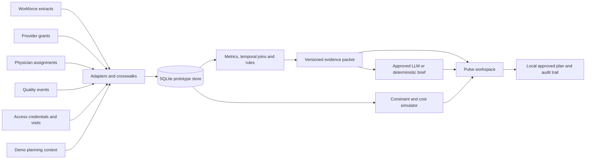

# symPulse — product requirements

Version 1.0 • November 5, 2026 • Owner: Ankit Kommalapati • Theme: **Mission: Impact**

Status: build-ready hackathon definition. Two development days, November 5–6. All operational information is synthetic. This document specifies the application to build; the repository currently supplies research, requirements and a runnable data starter.

## 1. Product decision

**Build one exceptional investigation, not four equally elaborate screens.**

Pulse helps an operations leader answer: **“What could disrupt this unit over the next 72 hours, what evidence connects the signals, and which feasible intervention should we approve?”**

The hero experience is an ICU readiness investigation combining a gradual overtime trend, already reported staff absences, a physician assignment that crosses a privilege expiry, increased near-miss reporting and a vendor's incomplete access readiness. Pulse calculates the staffing consequences, explains the limits of the evidence, compares interventions and prepares a local action plan.

### Strategic fit

The Operations Platform already connects operational domains, and current Quality positioning includes emerging-risk insights and coordinated action. Pulse is a proposed cross-product readiness application within that direction. Its demonstrated value must be a reproducible decision spanning domains and time, beyond the sum of individual alerts. [Operations Platform](https://www.symplr.com/healthcare-platform), [symplr Quality](https://www.symplr.com/products/symplr-quality)

### Value proposition

“A single evidence-backed readiness brief, with a safe next action and transparent impact.”

### Non-goals for the hackathon

- A validated probability of harm, a clinical prediction or diagnosis.
- Proving that staffing pressure caused safety events.
- Reimplementing predictive scheduling, credentialing, incident management or facility access control.
- Connecting to production systems, handling patient data or writing back to symplr products.
- A universal optimizer, vector database, graph database, autonomous multi-agent platform or streaming infrastructure.
- Commercial pricing commitments or dollar savings presented as real customer outcomes.

## 2. Users and jobs

| Persona | Job to be done | Decision / output |
|---|---|---|
| House supervisor / staffing manager, primary | Prepare for upcoming coverage problems without searching five systems | Approve a feasible staffing plan |
| Operations leader / COO, buyer hypothesis | Understand the most consequential cross-domain issue and owner | Prioritize one investigation |
| Medical staff coordinator | Resolve an assignment's credential/privilege dependency | Verify renewal or find an authorized replacement |
| Quality reviewer | Interpret reporting changes and review contributing factors | Accept or reject the operational hypothesis |
| Access coordinator | Make an important scheduled visit ready | Complete verification or arrange a compliant alternative |

The MVP uses a seeded demo persona and local plan approval; production SSO and enterprise authorization are future work. Label the deployment accordingly.

## 3. Primary scenario and factual boundaries

Fictional **St. Mary's Demo Medical Center**, ICU. Demo clock: **2026-11-05 08:00 America/Chicago**. Historical data precedes the clock; schedules and known deadlines extend beyond it.

1. Historical ICU overtime share has drifted upward relative to a frozen baseline. The UI computes the change from records; it never hardcodes the concept's “22%.”
2. Three approved unavailability notices affect the November 6 day shift. Eight RN assignments were planned; five remain available. The synthetic staffing requirement is eight, yielding **36 uncovered RN-hours** over 12 hours.
3. Two Step-down nurses have valid ICU competency, no conflicting assignments after reassignment, acceptable hours/rest and source-unit capacity. Reassignment adds 24 ICU RN-hours while preserving Step-down's required coverage; **12 RN-hours remain uncovered**.
4. A provider's active grant ends before the end of an upcoming ICU assignment. Show the unqualified interval and separate physician coverage exposure. A second pending renewal retains a grant valid throughout its assignment and does not reduce eligible coverage.
5. Quality reports have increased. Pulse displays reporting delay and denominator context and states that the trend does not establish higher underlying harm or causation.
6. A planned service visit has a required credential awaiting verification. Access status and the local visit dependency are linked, but no equipment outage is inferred.

The staffing changes do not resolve the privilege, quality-review or vendor-readiness issues. Keep them open with distinct owners. Do not collapse these into a made-up “risk reduced by 63%” outcome.

## 4. Scope and cut lines

| Priority | Requirement | Why |
|---|---|---|
| P0 | Reproducible source-shaped synthetic records and crosswalks | Credible joins and inspectable evidence |
| P0 | Historical overtime drift and future schedule eligibility checks | Real analytical behavior |
| P0 | Cross-domain ICU investigation with record-level citations | Product centerpiece |
| P0 | Deterministic float vs overtime vs agency comparison | Measurable decision impact |
| P0 | Ineligible-candidate explanation and source-unit constraints | Demonstrates operational judgment |
| P0 | Local approval plan, audit trail and unresolved items | Completes the decision loop |
| P0 | Offline deterministic evidence brief | Reliable demo when model unavailable |
| P1 | Live approved LLM explanation and bounded follow-up questions | Adds conversational investigation |
| P1 | Time replay and one negative-control investigation | Makes earlier detection testable |
| P1 | Independent fixture evaluation with saved results | Credible performance evidence |
| P2 | Additional units, scenario editor, polished graph animation | Only after P0 passes |

If time is short, cut broad overview charts, free-form chat, animation and additional risk families. Preserve evidence, constrained simulation and honest impact arithmetic.

## 5. Core experience

### A. Overview: “Needs your attention”

Show one high-priority ICU investigation, a short reason, next affected shift, affected domains, open coverage hours, evidence freshness and owner. Comparison departments provide context. Display “No investigation” separately from “Insufficient / stale data.”

Use priority bands with reason codes, not an uncalibrated probability or hospital-wide health score. A banner reads **“Synthetic demonstration • Frozen clock Nov 5, 08:00 CT.”**

### B. Investigation workspace: primary screen

Above the fold: title, time window, confirmed staffing gap, affected assignment/visit, evidence coverage and recommended next step. Below: four domain lanes with timeline and a shared unit/time context; observations, hypotheses and unknowns; source record drawer; actions.

Each observation includes numerator/denominator where applicable, comparison window, source records, last update and algorithm reason. A claim may cite many records through an inspectable aggregate: formula, record IDs or query identity, input hash and data version must be recoverable.

Evidence drawer: source label, extract name, record ID/version, source code and canonical mapping, occurred/effective time, available time and safe record payload. Use local evidence links. Do not fabricate live symplr deep links or official screen replicas.

Questions allowed in P1: “Why this unit?”, “What supports the staffing concern?”, “Why was this nurse excluded?”, “What remains unresolved?” Answers operate on the selected evidence packet, not unrestricted database access.

### C. Compare interventions: same workspace

Three cards share the same time window and requirement:

- **Internal reassignment:** two eligible nurses moved for one shift; source unit remains covered; residual ICU gap visible.
- **Voluntary overtime:** only eligible, available, rest-compliant staff; displayed as contingent on acceptance. If nobody qualifies, mark infeasible rather than inventing capacity.
- **Agency:** configurable demo slots with explicit availability assumption, onboarding lead time and cost. Unknown availability is not confirmed coverage.

An optional fourth **hybrid** combines two reassignments and one hypothetical confirmed agency slot. A plan is feasible only when each slot is individually assigned and every hard constraint passes.

Outputs: ICU required/covered/uncovered RN-hours, source-unit balance by shift, incremental cost and total modeled labor cost, implementation assumptions, consent dependencies, rejected candidates and unresolved nonstaffing tasks. Compare both target and donor unit together.

### D. Approve plan and follow through

Button: **“Approve demo plan”**. Before approval, show exact proposed assignments and task owners. Persist a local plan plus an audit event. Approval never changes source grants, vendor compliance or external schedules.

Plan lifecycle: draft → awaiting approval → approved → simulated implementation → monitoring → closed. Approval alone must not show “resolved.” Close only after synthetic outcome records or an explicitly labeled simulated completion event support resolution. Dismissal requires a reason and remains auditable.

## 6. Functional requirements and acceptance

| ID | Requirement | Acceptance |
|---|---|---|
| FR01 | Ingest JSONL fixtures through adapters | Source counts/hash match manifest; malformed rows quarantined; stable IDs preserved |
| FR02 | Resolve identity | All hero joins use explicit facility/unit/person mappings; ambiguous codes do not autojoin |
| FR03 | Enforce as-of time | No `available_at > as_of` row is used; scheduled future facts remain eligible when already known |
| FR04 | Compute actual metrics | Overtime share and report rates reconcile to input records; empty denominator displays unavailable |
| FR05 | Detect drift | Seeded gradual-change fixture triggers with method/baseline/reason; stable seasonal control does not |
| FR06 | Check future eligibility | Grant valid for full assignment interval; pending renewal alone is not loss of privilege |
| FR07 | Correlate context | Shared canonical unit plus overlapping relevant intervals required; cross-unit distractor excluded |
| FR08 | Ground explanation | Every factual claim references authorized packet evidence; invalid references fail validation |
| FR09 | Handle uncertainty | Reporting confounders, stale feeds and unknown capacity remain explicit |
| FR10 | Simulate interventions | No overlap, qualification, source-coverage, rest or hours violations; residual gaps displayed |
| FR11 | Produce plan | Owner, due time, exact changes, approvals, snapshot hash and audit events saved |
| FR12 | Preserve demo reliability | Offline brief, repeatable reset and model timeout fallback complete the same flow |

## 7. Analytical specification

All thresholds below are **initial demo configuration**, not clinically validated limits. Keep them versioned and visible to reviewers.

### 7.1 Metrics

- `overtime_share = classified_overtime_hours / productive_paid_hours`. Productive paid time includes regular and overtime work; excludes leave. Also display absolute overtime hours and period length.
- `absence_share = approved_unavailable_assigned_hours / planned_assigned_hours` for the known future window. Do not mix with retrospective call-out rate.
- `coverage_gap_hours = sum over 15-minute intervals max(0, required_eligible_RNs - assigned_eligible_RNs) * 0.25`. A 12-hour constant deficit of three produces 36 RN-hours.
- `near_miss_report_rate = known_near_miss_reports / synthetic_patient_days * 1000`. Count by event occurrence window with `available_at <= as_of`; mark incomplete recent periods. No denominator → counts only, no rate claim.
- `privilege_exposure_hours = duration of assigned service lacking a qualifying grant`, kept in physician-hours rather than added to RN-hours.
- `visit_readiness = required credentials approved and valid for the visit interval under its facility policy`.

### 7.2 Drift and anomaly

Start with 90 completed historical days. Freeze the first 56 completed days as baseline; later days are monitored. Compare within unit and shift class; adjust for weekday using baseline weekday means, and require sufficient observations before fitting. A simple EWMA on standardized residuals detects persistent shifts. EWMA is a well-established transparent monitoring method. [NIST EWMA reference](https://www.itl.nist.gov/div898/handbook/pmc/section3/pmc324.htm)

Prototype configuration: lambda 0.25; baseline standard-deviation floor to avoid zero-variance division; upper boundary 3 times the EWMA standard deviation; require three consecutive breaches plus a meaningful absolute increase in overtime share. Use the finite-time variance factor `lambda/(2-lambda) * (1-(1-lambda)^(2*t))`. Baseline uses only prior available records. Do not silently retrain on the deteriorating period.

One-point anomaly is a separate 3-standard-deviation residual plus minimum-volume rule. Sparse quality events use complete 21-day count/rate comparisons with minimum counts rather than pretending a Gaussian daily model is reliable. Quality trend alone creates a review note, not a critical alert. Isolation Forest and change-point packages are optional later experiments, not P0 dependencies.

### 7.3 Cross-domain investigation rules

Rule R1: future RN gap + workforce drift → staffing-pressure investigation.

Rule R2: physician assignment intersects an invalid grant interval → independent provider-readiness finding linked to the unit. Expiry outside all assignments produces a renewal task only.

Rule R3: required vendor credential incomplete at a planned unit visit → access-readiness finding; priority depends on explicit planning-context importance and visit proximity.

Rule R4: recent quality-report trend coexists in the same unit → contextual evidence and quality-review action; no causal edge inferred.

Group R1–R4 into one unit readiness investigation when their future dependency windows overlap the next 72 hours or historical evidence supports that unit's current review. Display the exact join path, not “AI discovered correlation.” Shared department alone is contextual association; it is not statistical correlation or causality.

High priority: a confirmed upcoming eligibility/coverage gap within 72 hours plus at least one other current readiness concern. Medium: drift with no near-term gap or a deadline requiring verification. Informational: renewal follow-up with valid current eligibility. Missing critical data produces “review required; completeness limited,” not low risk.

Deduplication key: facility + unit + investigation family + intersecting action window. Update existing open investigation with new evidence versions; avoid one alert per event. Maintain a timeline of changed priority and reasons.

### 7.4 LLM contract

The deterministic engine supplies a bounded packet: facts, computed metrics, evidence IDs, join paths, permitted actions, model-calculated simulation outputs, uncertainty and data freshness. The implemented model contract selects and orders certified statements instead of generating unrestricted prose:

```json
{
  "summary_id": "review",
  "observation_ids": ["staffing-hours"],
  "hypothesis_ids": [],
  "unknown_ids": ["operational-only", "completeness"],
  "recommended_action_ids": ["review-staffing"],
  "remaining_risk_ids": ["separate-reviews"]
}
```

IDs are validated against the question-specific catalog, including all mandatory findings and caveats; the abbreviated example illustrates shape, not a valid complete response for every investigation. The server renders certified text and evidence links. Unsupported IDs, extra prose, invented action membership and omitted mandatory limits are rejected. Source narratives are excluded from the provider catalog and cannot modify instructions or tool permissions.

Preserve model/version, prompt version, packet hash, generation time, validation outcome and fallback status. Cache by snapshot and contract identity. Each model attempt defaults to a total 10-second bound with one transient retry at most, then a visibly labeled deterministic brief. See [implemented explanation contract](EXPLANATIONS.md) for configuration, retry behavior and verification limits.

AWS Bedrock is consistent with symplr's public AI positioning; actual model access and company approval are unverified. Use whichever approved endpoint the user already has. Keep a provider interface; model provisioning must not block the rest of the application. [symplr AI](https://www.symplr.com/platform/ai-in-healthcare)

## 8. Simulation specification

Inputs are versioned assignments, requirements, unavailability, qualification validity, facility permissions, consent state, shift costs and optional agency slots. Outputs are deterministic given those inputs and the plan.

Hard constraints: active employment; RN role; valid license and documented ICU competency throughout shift; permitted facility/unit; no unavailability; no overlapping work; configurable rest buffer; configurable weekly/daily hours; required source-unit coverage at every interval. Prototype values such as 12-hour rest or 60 weekly hours are illustrative hospital-policy inputs, not universal standards or legal conclusions.

Reassignment replaces the original source assignment for the interval and adds the destination assignment. It does not duplicate paid hours. Check all proposed moves together: two individually feasible nurses may jointly under-cover their source unit. Distinguish existing scheduled hours from additional overtime.

For a simple fixture use a base rate of $50/hour, voluntary overtime at $75/hour and agency at $110/hour. If three 12-hour agency shifts would cover the target gap, agency-only cost is $3,960. Two already-paid eligible reassignments plus one agency shift incur $1,320 incremental coverage cost, a **modeled $2,640 difference** under those assumptions. Base donor pay still exists; include both units in total cost and show that the difference is avoided incremental agency spend, not cash saved or realized ROI. The application computes these staffing and cost comparisons; see [simulation behavior and verification](SIMULATION.md) for the implemented scope and limits.

Simulation estimates staffing arithmetic and labor cost. It cannot estimate safety-event reduction, avoided harm, avoided downtime or provider/vendor workflow completion without additional evidence.

## 9. Architecture and implementation decisions



Recommended two-day stack: Next.js/React/TypeScript UI with a single Python FastAPI service reading SQLite. Python keeps the supplied data generator usable and supports straightforward statistical calculations. Use standard SQL joins; NetworkX is optional only if visualization needs it. Recharts for the one drift chart; ordinary UI components for evidence and comparison cards. Docker and PostgreSQL are post-demo packaging options. If an existing team template favors a single runtime, preserve the data contract and collapse the service boundary.

Proposed application API, explicitly **Pulse APIs**, not symplr APIs:

| Route | Contract |
|---|---|
| `GET /api/investigations?as_of=` | Brief list, freshness, priority reasons |
| `GET /api/investigations/{id}` | Versioned evidence packet and computed metrics |
| `GET /api/evidence/{id}` | Authorized source record or aggregate provenance |
| `POST /api/investigations/{id}/explain` | Validated model brief or labeled fallback |
| `POST /api/investigations/{id}/simulate` | Snapshot hash + interventions → feasibility, costs, gaps |
| `POST /api/plans` | Save proposal from a valid simulation |
| `POST /api/plans/{id}/transition` | Explicit lifecycle change including demo approval; reject stale snapshot/version |
| `GET /api/evaluation` | Saved fixture results, excluded from model evidence |

## 10. Data quality, trust and reliability

- Prominent synthetic badge, source labels and a fixed clock on all screens.
- User input cannot run SQL or trigger source-system actions.
- Explicit freshness per feed, with prototype thresholds rather than invented vendor SLAs.
- Idempotent upsert by source + record ID + version; revised and deleted records handled intentionally.
- Future effective times are permitted for planned facts; future availability is never permitted at replay time.
- Store UTC, display hospital local time with zone/offset and compare actual elapsed time.
- Data-health exceptions do not silently become operational deterioration.
- No employee ranking or punitive quality attribution. Use individual identities only for assignment eligibility in synthetic data.
- Model timeout/offline path and one-command reset; startup requires no external call except optional live explanation.
- Production permissions, privacy review, enterprise access, reliability targets and product certification are later requirements. Pulse inherits no certification from source products. [symplr security context](https://www.symplr.com/platform/technology-security)

Local performance targets, to measure rather than claim: load overview under 2 seconds warm; deterministic simulation under 1 second for the seeded dataset; cached brief under 1 second. Save actual timing on the demo machine.

## 11. Measurement and evaluation

The included generator provides **30 labeled analytical fixtures**, six each for drift, provider readiness, access readiness, staffing feasibility and quality-report interpretation. They are component-level challenge inputs, not 30 independently simulated hospitals and not proof of real-world accuracy. Families have different labels and should not be pooled into a single accuracy claim. The full hero dataset is a separate integration case.

Split fixture families into tuning and held-out evaluation before adjusting thresholds. Freeze configuration and report held-out precision/recall by rule family and denominators, plus observed failures. Add several perturbation seeds if time permits; do not tune a threshold against every evaluation label and then advertise the same score as generalization.

| Metric | Definition | Hackathon target, not result |
|---|---|---|
| Scenario precision/recall | Matched detections / labeled positives and emitted findings | ≥0.85 each on held-out synthetic cases; show counts |
| Constraint safety | Infeasible proposed plans correctly rejected | All must-pass eligibility and combined donor-coverage cases |
| Evidence validity | Factual claims with resolvable supporting references | 100% of displayed facts |
| Replay integrity | Records used with availability after replay clock | Zero |
| Detection lead time | First baseline alert time minus first Pulse alert time | Measure only against declared baseline and identical as-of inputs |
| Investigation effort | Timed manual evidence-assembly task versus Pulse-assisted task | Record both timings and method; no invented reduction |
| Alert consolidation | Raw domain findings versus grouped investigation count | Show observed grouping; grouping is not precision improvement |
| Labor impact | Agency-only incremental cost minus proposed plan cost | Modeled comparison with editable assumptions |

Baseline: separately display staffing-gap, expiry, vendor and quality flags at declared thresholds, with the same availability clock. Do not hide obvious single-system warnings to manufacture Pulse's advantage. Pulse can win through faster evidence assembly even if it does not alert earlier.

Near-miss reporting is not an outcome to minimize blindly. Actual safety impact requires later study. [AHRQ reporting evidence](https://www.ahrq.gov/sites/default/files/2025-05/fraser-dunagan-report.pdf)

## 12. Release gate and commercial continuation

Demo release gate: all hero records reconcile; one invalid nurse is visibly rejected; pending-valid renewal is not counted as a physician gap; float plan preserves donor coverage; residual gap is shown; LLM failure completes via fallback; approval persists locally; no safety or financial outcome is misrepresented.

After the hackathon: confirm roadmap overlap with product leadership; obtain approved sample exports and data owners; validate workflow fit with staffing/medical staff/quality/access users; run a retrospective synthetic-to-authorized-data feasibility pilot; measure investigation time and action acceptance. Commercial packaging hypothesis is an add-on readiness workflow for existing multi-product customers. Pricing, market size and willingness to pay remain discovery questions.
